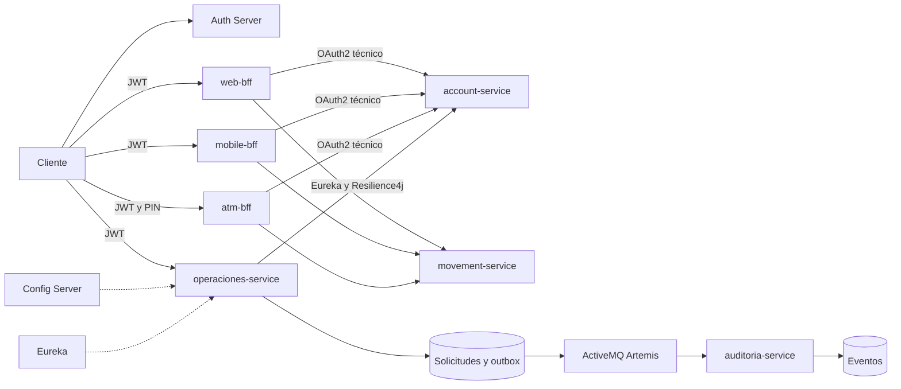

# Banco XYZ con OAuth2 y microservicios resilientes

Desarrollo Backend III PBY2203, experiencia 3, semana 8. Esta entrega continúa el proyecto [lcaviles1/Exp2_Backend](https://github.com/lcaviles1/Exp2_Backend), commit `ec04000c3d7be4f3d8e0ea245248b76f279ea791`. Conserva los cinco módulos originales, sus modelos, reglas bancarias, importadores CSV, respuestas por canal, interfaces y pruebas. Añade OAuth2/JWT, Spring Cloud Config, Eureka, Resilience4j y mensajería JMS, con una única orquestación Docker Compose.

## Continuidad y propuesta técnica

`account-service` mantiene la lectura y limpieza de cuentas y los retiros; `movement-service` conserva el procesamiento del historial. `web-bff`, `mobile-bff` y `atm-bff` mantienen la agregación y los contratos diferenciados de los tres canales. Los datos de entrada son los archivos `legacy-data/` del repositorio original.

La evolución reemplaza el token estático interno como control de acceso por OAuth2 con scopes. El PIN del cajero sigue siendo una comprobación adicional, configurada fuera del código. Cada BFF obtiene un JWT técnico para comunicarse con los servicios, incluso desde los hilos de agregación asíncrona. Web y móvil solicitan permisos de lectura; cajero solicita además `cuentas.write`. Las APIs de los canales también requieren un JWT del cliente externo.

Se incorporan cinco módulos: `auth-server`, `config-server`, `discovery-server`, `operaciones-service` y `auditoria-service`. Operaciones consulta el **account-service original** a través de Eureka y Resilience4j. Registra solicitudes con clave idempotente y guarda un evento en una outbox transaccional. Auditoría consume los eventos mediante ActiveMQ Artemis y elimina duplicados por `eventId`.

Las solicitudes nuevas de Operaciones no ejecutan un movimiento de dinero: el retiro efectivo de demostración sigue siendo responsabilidad del flujo original ATM → Account. Los eventos `OperacionRegistrada` corresponden a esas solicitudes nuevas, no a los retiros del cajero.

## Arquitectura y estructura



Config Server distribuye la configuración común de emisor, audiencia, JWKS y Eureka a los ocho servicios clientes. Las conexiones BFF → Account/Movement mantienen los nombres DNS de Compose de la arquitectura original; la nueva integración Operaciones → Account usa descubrimiento y balanceo de Spring Cloud.

| Carpeta | Responsabilidad |
|---|---|
| `account-service/` | Cuentas, calidad del CSV y retiros originales; adaptador `/api/cuentas` |
| `movement-service/` | Historial, resumen y calidad de movimientos originales |
| `web-bff/` | Dashboard web y agregación enriquecida |
| `mobile-bff/` | Respuesta compacta para móvil |
| `atm-bff/` | Consulta de saldo, sesión y retiros con PIN |
| `auth-server/` | Clientes OAuth2, scopes y firma RSA persistente |
| `config-server/`, `config-repo/` | Configuración central protegida |
| `discovery-server/` | Eureka protegido |
| `operaciones-service/` | Resilience4j, idempotencia, persistencia y outbox |
| `auditoria-service/` | Consumo JMS y persistencia de eventos |
| `legacy-data/` | CSV del proyecto original incluidos en Account y Movement |
| `scripts/` | Generación de credenciales y demostración integrada |
| `evidencias/` | Salidas reales de compilación, contenedores y ejecución |

Versiones: Java 21, Spring Boot 3.5.16, Spring Cloud 2025.0.3, Resilience4j 2.3.0 y ActiveMQ Artemis 2.42.0. Un Dockerfile multietapa genera diez imágenes propias; la compilación ejecuta `mvn verify`. Las aplicaciones se ejecutan sin privilegios y el broker no expone puertos al host.

## Ejecución

Requisitos: Docker con Compose v2 o posterior, Python 3.10 o posterior y conexión a Internet para la primera compilación. Asigne preferentemente 8 GB de memoria a Docker. No necesita instalar Java ni Maven cuando usa contenedores.

Desde la carpeta que contiene `docker-compose.yaml`:

```bash
python3 scripts/configurar.py
docker compose config --quiet
docker compose up -d --build --wait --wait-timeout 240
docker compose ps
python3 scripts/demostrar.py
```

En Windows puede usar `python` en lugar de `python3`. El script inicial crea `.env` con secretos aleatorios y un PIN local. No sobrescribe un `.env` existente. Mantenga las mismas credenciales mientras conserve los volúmenes; cambiar la contraseña de una base existente requiere migrarla.

Compose arranca según dependencias y salud. Los puertos publicados se limitan a `127.0.0.1`; las credenciales y la clave privada no se incluyen en la entrega. La configuración central se copia a las imágenes: tras editarla, repita el comando con `--build`.

| Servicio | Puerto local |
|---|---|
| OAuth2 | 9000 |
| Config Server | 8888 |
| Eureka | 8761 |
| Account original | 8081 |
| Movement original | 8084 |
| Web BFF original | 8091 |
| Mobile BFF original | 8092 |
| ATM BFF original | 8093 |
| Operaciones | 8082 |
| Auditoría | 8083 |

Movement usa 8084 para reservar 8082 al nuevo servicio de Operaciones. Compose ajusta los destinos de todos los BFF. Las interfaces se abren en `http://localhost:8091`, `http://localhost:8092` y `http://localhost:8093`; piden pegar un JWT y el cajero también requiere el PIN de `.env`. El token se conserva solo en memoria de la página y expira a los cinco minutos.

## OAuth2 y uso de las APIs

Flujo `client_credentials` para clientes técnicos. El emisor y los resource servers verifican firma RSA, emisor, audiencia `banco-api`, vigencia y scopes. La clave RSA se conserva en un volumen. Config Server y Eureka requieren Basic con usuario `infra` y `INFRA_PASSWORD`; la salud mínima es pública.

En Bash o Zsh, obtenga el token sin mostrar el secreto:

```bash
set -a
. ./.env
set +a
TOKEN=$(curl -fsS -u "bank-cli:$BANK_CLIENT_SECRET" \
  -d 'grant_type=client_credentials' \
  --data-urlencode 'scope=cuentas.read operaciones.read operaciones.write auditoria.read movimientos.read bff.read atm.write' \
  http://localhost:9000/oauth2/token \
  | python3 -c 'import json,sys; print(json.load(sys.stdin)["access_token"])')
curl -fsS -H "Authorization: Bearer $TOKEN" \
  http://localhost:8091/api/web/accounts/101/dashboard
```

Para usar una interfaz local, copie el valor de `$TOKEN` desde su propia terminal. No comparta tokens ni el `.env`. El cliente `bank-reader` y `READER_CLIENT_SECRET` solo tienen `cuentas.read` y `operaciones.read`. `bff-service` usa `BFF_CLIENT_SECRET` en el servidor; ese secreto nunca se entrega al navegador.

| Método y ruta | Scope |
|---|---|
| `GET :8081/internal/accounts/{id}` | `cuentas.read` |
| `GET :8081/internal/data-quality` | `cuentas.read` |
| `POST :8081/internal/accounts/{id}/withdrawals` | `cuentas.write`, reservado al cliente técnico BFF |
| `GET :8084/internal/accounts/{id}/movements-overview` | `movimientos.read` |
| `GET :8084/internal/data-quality` | `movimientos.read` |
| `GET :8091/api/web/accounts/{id}/dashboard` | `bff.read` |
| `GET :8092/api/mobile/accounts/{id}/home` | `bff.read` |
| `GET :8093/api/atm/accounts/{id}/session` | `bff.read` y cabecera `X-ATM-PIN` |
| `GET :8093/api/atm/accounts/{id}/balance` | `bff.read` y `X-ATM-PIN` |
| `POST :8093/api/atm/accounts/{id}/withdrawals` | `atm.write` y `X-ATM-PIN` |
| `GET :8081/api/cuentas`, `/{id}`, `/importacion` | `cuentas.read` |
| `GET :8082/api/operaciones`, `/outbox` | `operaciones.read` |
| `GET :8082/api/operaciones/contexto/{id}` | `operaciones.read` y `cuentas.read` |
| `GET :8082/api/resiliencia` | `operaciones.read` |
| `POST :8082/api/operaciones` | `operaciones.write` y `cuentas.read` |
| `GET :8083/api/eventos` | `auditoria.read` |

Ejemplo de solicitud nueva:

```bash
curl -i -X POST http://localhost:8082/api/operaciones \
  -H "Authorization: Bearer $TOKEN" \
  -H 'Content-Type: application/json' \
  -H 'Idempotency-Key: solicitud-manual-001' \
  -d '{"cuentaId":101,"tipo":"DEPOSITO","monto":125.50}'
```

La clave admite de 8 a 80 letras, números, guiones y guiones bajos. Repetir clave y contenido conserva el identificador; reutilizarla con otro contenido produce 409. El monto debe ser positivo, con hasta doce enteros y dos decimales. Los retiros del ATM conservan la regla original de múltiplos positivos de 1000 y validación de saldo suficiente.

## Resiliencia y eventos

Operaciones limita la conexión a Account a un segundo y la lectura a dos. Aplica Bulkhead de ocho llamadas concurrentes, CircuitBreaker y Retry de hasta tres intentos separados por 200 ms. No reintenta HTTP 4xx. El circuito usa ventana de cuatro llamadas lógicas, mínimo cuatro, umbral de fallo 50 %, espera abierta de ocho segundos y dos llamadas de prueba en HALF_OPEN.

La lectura de contexto devuelve `DEGRADADO` si Account falla, sin inventar saldos. La escritura responde 503 sin registrar una solicitud parcial. Los errores de autorización y de cuenta inexistente conservan sus códigos.

La solicitud y el evento se insertan en una transacción local. El publicador envía mensajes persistentes a `banco.operaciones` cada dos segundos, con lotes de hasta 50. Si el broker falla, la outbox conserva el evento pendiente. La entrega es al menos una vez: Auditoría deduplica por `eventId` y confirma JMS después de completar la transacción local. La versión despliega un publicador y un consumidor; escalar requiere coordinación de la outbox y bases compartidas por servicio.

## Pruebas y evidencia de ejecución

La compilación incluye las pruebas originales de cuentas, movimientos y los tres BFF, además de las pruebas de idempotencia, reintentos, bulkhead y consumo duplicado de la ampliación. Puede ejecutarlas también con Java 21 mediante `./mvnw -B -ntp verify`.

`scripts/demostrar.py` prueba los diez servicios, obtiene tokens, comprueba 401 y 403, consulta los tres canales originales, rechaza un PIN incorrecto y efectúa un retiro de demostración. Registra una solicitud nueva, comprueba idempotencia y entrega JMS, detiene Account para observar el circuito y recupera el servicio. Después detiene Artemis, registra un evento pendiente, recupera el broker y reinicia Auditoría para comprobar persistencia.

El script escribe `evidencias/ejecucion-consola.txt` sin secretos ni tokens. Detiene servicios temporalmente y vuelve a iniciarlos con `finally`; ejecútelo solo en el laboratorio. Si se interrumpe por cierre del proceso, use `docker compose up -d --wait`. Las evidencias incluidas corresponden a esta arquitectura adaptada, no a la versión anterior del ZIP.

## Datos y límites del laboratorio

Los importadores originales usan los CSV de `legacy-data/`, derivados del caso `KariVillagran/bank_legacy_data`. Conservan sus políticas de limpieza y primera cuenta válida por identificador. La API `/internal/data-quality` mantiene el desglose original de inválidos y duplicados; el adaptador `/api/cuentas/importacion` presenta ese mismo resumen, sin inventar rechazos por fila que el importador original no almacena.

Account y Movement conservan el almacenamiento en memoria del proyecto base. Los retiros modifican el saldo durante esa ejecución y se reinician desde CSV al reiniciar Account. Las solicitudes, outbox, eventos y clave RSA nuevos sí tienen persistencia en volúmenes. No se presenta el laboratorio como un sistema contable productivo ni se afirma auditoría de todos los retiros.

Para producción se requieren HTTPS, gestión y rotación de secretos, autorización por titular, PIN individual con protección contra intentos, almacenamiento transaccional persistente para Account, idempotencia de retiros, TLS interno, backups y réplicas de los componentes únicos. La configuración entregada sirve para una máquina cloud con Docker; no acredita despliegue efectivo en un proveedor ni alta disponibilidad. `OAUTH_ISSUER` debe coincidir en emisor y consumidores al configurar un dominio público.

## Operación

```bash
docker compose ps
docker compose logs --tail=100 operaciones-service auditoria-service
docker compose down
```

`down` conserva los volúmenes. `down -v` elimina los datos de demostración, incluidos eventos y claves; úselo únicamente cuando quiera reiniciar completamente el laboratorio. No reutilice credenciales distintas con volúmenes creados previamente.

## Referencias

- [Proyecto base Exp2_Backend](https://github.com/lcaviles1/Exp2_Backend).
- [Datos del caso bancario](https://github.com/KariVillagran/bank_legacy_data).
- [Spring Cloud](https://spring.io/projects/spring-cloud/).
- [Spring Authorization Server](https://docs.spring.io/spring-authorization-server/reference/getting-started.html).
- [JMS en Spring Boot](https://docs.spring.io/spring-boot/3.5/reference/messaging/jms.html).
- [Resilience4j](https://resilience4j.readme.io/docs/circuitbreaker).
- [Docker Compose](https://docs.docker.com/compose/how-tos/startup-order/).
